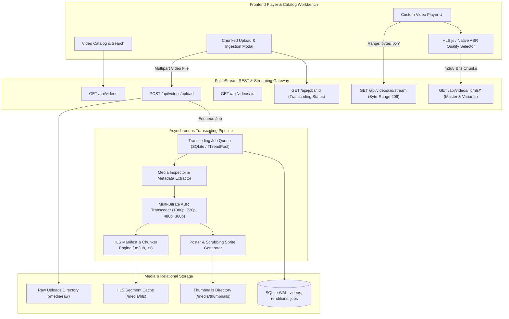

# PulseStream: Production Video Streaming Platform

PulseStream is a high-performance, production-grade video streaming platform built with **HTTP Live Streaming (HLS)**, **Adaptive Bitrate (ABR)** packaging, RFC 7233 compliant **Byte-Range Streaming**, an asynchronous background transcoding job queue, and a custom HTML5 web video player workbench.

---

## 1. System Architecture



---

## 2. Technical Capabilities

### 2.1 RFC 7233 Byte-Range Progressive Video Streaming
- Full compliance with RFC 7233 range specifications.
- Handles explicit ranges (`Range: bytes=0-1048575`), open-ended ranges (`Range: bytes=1048576-`), and suffix ranges (`Range: bytes=-524288`).
- Emits `206 Partial Content` with `Content-Range: bytes start-end/total`, `Accept-Ranges: bytes`, and exact `Content-Length`.
- Returns `416 Range Not Satisfiable` with `Content-Range: bytes */total` for out-of-bounds queries.
- Utilizes chunked file stream generators (64 KB buffers) to eliminate full-file memory allocations.

### 2.2 Adaptive Bitrate (ABR) HLS Packaging Engine
- Multi-bitrate transcode profiles adhering to industry standards:
  - **1080p (FHD):** 1920x1080, 4,500 kbps, 60fps
  - **720p (HD):** 1280x720, 2,500 kbps, 30fps
  - **480p (SD):** 854x480, 1,000 kbps, 30fps
  - **360p (Mobile):** 640x360, 600 kbps, 30fps
- Generates master playlists (`master.m3u8`) with `#EXT-X-STREAM-INF` tags containing bandwidth, resolution, and codecs.
- Produces variant media playlists (`stream_720p.m3u8`) with precise segment duration tags (`#EXTINF:4.000000`).
- Dual-engine segmenter: pure-Python 188-byte MPEG-2 Transport Stream (TS) packet synthesis with PAT and PMT tables, with automatic fallback and acceleration via system FFmpeg binaries when present.

### 2.3 Asynchronous Transcoding Queue & Worker Service
- Background daemon worker thread polling SQLite WAL for queued processing jobs.
- Deterministic 4-stage processing lifecycle:
  - **15% (Inspecting):** ISO BMFF container parsing, duration, bitrate, and codec detection.
  - **30% (Thumbnailing):** Poster image generation saved to media storage.
  - **50% (Packaging HLS):** Multi-bitrate MPEG-2 TS chunking without source upscaling.
  - **85% (Saving Renditions):** Persisting ABR stream profiles into SQLite.
  - **100% (Completed):** Video status updated to `ready`.
- Resilient failure recovery: isolates corrupt containers or missing inputs without crashing the daemon loop.

### 2.4 Modern Web Video Player Interface (PulseStream UI)
- Custom responsive HTML5 video player wrapping native video elements.
- Dual-bar scrubber with `#bufferedBar` displaying cached video time ranges and `#progressBar` enabling smooth scrubbing.
- Dynamic ABR resolution picker powered by Hls.js level inspection.
- Drag-and-drop video upload modal with real-time job stage telemetry tracking.
- Debounced keyword search across titles and descriptions with category pill navigation.

---

## 3. Directory Layout

```
week43_video_streaming/
├── backend/
│   ├── app/
│   │   ├── config/          # Environment configuration and ABR rendition profiles
│   │   ├── db/              # SQLite WAL connection manager and table initialization
│   │   ├── models/          # VideoModel, CategoryModel, TranscodingJobModel DAOs
│   │   ├── routes/          # REST API endpoints (videos, jobs, health, static)
│   │   ├── services/        # StorageService, MediaInspector, RangeStreamingEngine, HLSPackager
│   │   └── transcoding/     # Standard quality profiles and profile selector
│   ├── data/                # SQLite schema and database files
│   ├── media/               # Storage directories (raw, hls, thumbnails)
│   ├── tests/               # Pytest suite (unit, integration, e2e, chaos)
│   ├── requirements.txt     # Python dependencies
│   └── run.py               # Application entrypoint
└── frontend/
    ├── public/
    │   └── index.html       # Single-page video workbench entrypoint
    └── src/
        ├── assets/          # Base styling, catalog grid, and player CSS
        ├── player/          # PulsePlayer and HLSController modules
        ├── ui/              # CatalogView and UploadModal controllers
        └── app.js           # Main client orchestrator
```

---

## 4. REST API Reference

| Method | Endpoint | Description |
|---|---|---|
| `GET` | `/api/health` | System health check (database, disk storage stats) |
| `POST` | `/api/videos/upload` | Multipart video file upload and queue ingestion |
| `GET` | `/api/videos` | List video catalog with category and search query filters |
| `GET` | `/api/categories` | Retrieve categories with video item counts |
| `GET` | `/api/videos/<id>` | Video details with renditions and view counter increment |
| `GET` | `/api/videos/<id>/stream` | Progressive byte-range streaming (`206 Partial Content`) |
| `GET` | `/api/videos/<id>/hls/<file>` | Serves HLS master manifests, variant playlists, and TS chunks |
| `GET` | `/api/thumbnails/<file>` | Serves poster thumbnail images with traversal guards |
| `DELETE` | `/api/videos/<id>` | Cascading deletion of records and media storage assets |
| `GET` | `/api/jobs/<job_id>` | Real-time transcoding job progress and stage polling |
| `GET` | `/api/jobs/video/<video_id>` | Query latest transcoding job for a video ID |
| `GET` | `/api/jobs/active` | List all active or queued transcoding tasks |

---

## 5. Web Player Keyboard Shortcuts

| Shortcut | Action |
|---|---|
| `Space` / `K` | Toggle Play / Pause |
| `F` | Toggle Fullscreen mode |
| `M` | Toggle Mute |
| `Left Arrow` | Seek backward 5 seconds |
| `Right Arrow` | Seek forward 5 seconds |
| `Up Arrow` | Increase volume by 10% |
| `Down Arrow` | Decrease volume by 10% |
| `0` - `9` | Seek to 0% - 90% timeline position |

---

## 6. Quality Gates & Verification

PulseStream enforces 5 strict quality gates:

1. **Flake8:** Enforces PEP 8 standards with an 88-character line limit.
2. **Black:** Formatted Python code style.
3. **isort:** Deterministic import sorting with `--profile black`.
4. **Bandit:** AST-based security vulnerability analysis.
5. **Pytest:** Comprehensive automated test suite with coverage >= 90%.

```bash
# Run Flake8 linter
python -m flake8 --max-line-length=88 app tests

# Run Black code formatter check
python -m black --check app tests

# Run isort import sorter check
python -m isort --check-only --profile black app tests

# Run Bandit security vulnerability scanner
python -m bandit -r app

# Run Pytest suite with test coverage
python -m pytest tests -v --cov=app --cov-report=term-missing
```

---

## 7. Quickstart Guide

### Prerequisites
- Python 3.10+
- FFmpeg (optional, pure-Python fallback included)

### Setup & Run

```bash
# Navigate to backend directory
cd week43_video_streaming/backend

# Install dependencies
pip install -r requirements.txt

# Seed sample categories and video records
python data/seed.py

# Start PulseStream server
python run.py
```

The application will be accessible at `http://localhost:5000`.
