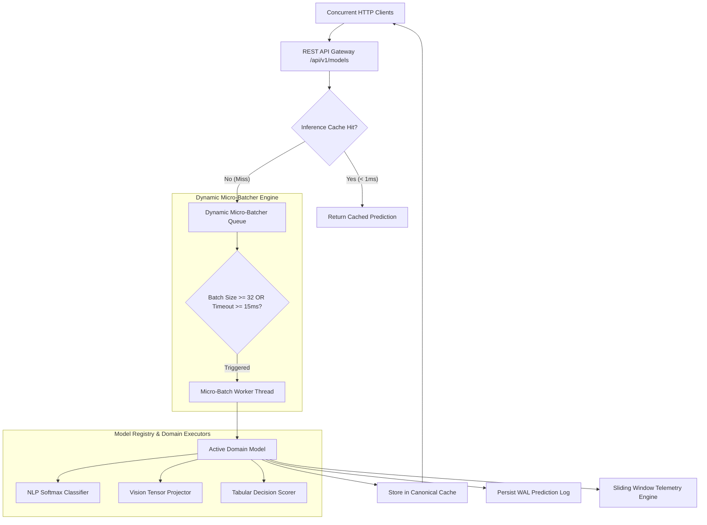

# PulseInfer: Production ML Model Serving & Inference Gateway

PulseInfer is a production-grade machine learning model serving and inference gateway engineered in Python and vanilla ES6 modules. It delivers ultra-low-latency model predictions across diverse domains (Natural Language Processing, Computer Vision, and Tabular Fraud Scoring) with dynamic micro-batching, LRU inference caching with canonical payload hashing, sliding-window telemetry, and zero-downtime version hot-swapping.

---

## 1. System Architecture

PulseInfer routes client inference requests through a high-performance orchestration layer designed to maximize throughput and minimize latency.



---

## 2. Core Capabilities

### Multi-Domain Model Architecture
- **PulseText (NLP Sentiment & Intent):** Subword vocabulary tokenizer with normalized Softmax probability distribution classification across sentiment categories (`positive`, `neutral`, `negative`).
- **PulseVision (Computer Vision Feature Classifier):** Decodes raw pixel arrays and base64 strings with mean/std channel normalization and projection tensors classifying visual content categories.
- **PulseRisk (Tabular Fraud Scorer):** Scaled decision boundary model calculating risk scores, calibrated thresholds, and risk tier categorization (`LOW`, `MEDIUM`, `HIGH`).

### Dynamic Micro-Batching
- In-flight client inference requests are aggregated dynamically into optimal micro-batches ($B \le 32$) with dual triggering: capacity limit and 15ms timeout window.
- Thread-safe coordination across client requests using synchronization barriers and isolated futures.

### Canonical Hash Inference Caching
- Thread-safe LRU in-memory cache indexing payloads via SHA-256 canonical serialization.
- Bypasses inference execution and micro-batch queuing on cache hits, yielding sub-millisecond response times.
- Supports configurable TTL expiration and automatic cache invalidation on model hot-swaps.

### Zero-Downtime Hot-Swapping
- Hot-swap active model versions (e.g., `v1` to `v2-rc1`) via atomic reference updates under read-write locking.
- In-flight requests drain cleanly without dropped connections or service interruption.

### Real-Time Observability & Telemetry
- Sliding-window latency tracking computing percentiles (`p50`, `p90`, `p95`, `p99`), throughput (req/s), error rates, and cache efficiency.
- SQLite WAL transaction logging recording individual prediction audits with sub-millisecond timing precision.

### In-Browser Concurrency Benchmarker
- Integrated client-side benchmarking suite simulating concurrent traffic (5 to 100 parallel workers) across configurable workload profiles (cache saturation, dynamic micro-batching, and mixed real-world traffic).
- Real-time client-measured quantile graphs, live progress bars, and operational summary insights.

---

## 3. REST API Specification

### Inference & Model Catalog Routes

| Method | Endpoint | Description |
|---|---|---|
| `GET` | `/api/health` | Comprehensive system health check (database, vault, registry) |
| `GET` | `/api/v1/models` | List all registered models with optional domain filtering |
| `GET` | `/api/v1/models/<model_id>` | Retrieve runtime status, active version, and batcher stats |
| `GET` | `/api/v1/models/<model_id>/metadata` | Retrieve schemas, validation contracts, and registered versions |
| `POST` | `/api/v1/models/<model_id>/predict` | Execute single-item model inference with cache/batcher |
| `POST` | `/api/v1/models/<model_id>/predict-batch` | Execute explicit multi-item batch inference |
| `POST` | `/api/v1/models/<model_id>/reload` | Trigger zero-downtime hot-swap to target version |

### Telemetry & Administration Routes

| Method | Endpoint | Description |
|---|---|---|
| `GET` | `/api/v1/metrics` | Global and per-model latency percentiles and cache telemetry |
| `POST` | `/api/v1/metrics/reset` | Reset telemetry sliding-window counters |
| `POST` | `/api/v1/cache/clear` | Purge all in-memory prediction cache entries |
| `GET` | `/api/v1/logs` | Fetch recent database prediction audit logs |

---

## 4. Quickstart Guide

### Prerequisites
- Python 3.10+
- Modern Web Browser (Chrome, Firefox, Safari, Edge)

### Installation & Initialization

1. Navigate to the backend directory:
```bash
cd week44_ml_model_api/backend
```

2. Install Python dependencies:
```bash
pip install -r requirements.txt
```

3. Seed the database with default models and weights:
```bash
python data/seed.py
```

4. Launch the PulseInfer Gateway server:
```bash
python run.py
```

5. Open your browser and navigate to:
```
http://localhost:5000/
```

---

## 5. Quality Verification & Test Coverage

PulseInfer enforces a 5-gate quality pipeline across all backend source code:

1. **Flake8:** Zero lint warnings adhering to strict 88-character line limits.
2. **Black:** 100% compliant deterministic code formatting.
3. **isort:** PEP 8 and Black profile import sorting.
4. **Bandit:** Zero high-, medium-, or low-severity security vulnerabilities.
5. **Pytest & Coverage:** 106 automated tests achieving 97% overall statement coverage.

### Running Quality Verification Suite

```bash
cd week44_ml_model_api/backend

# Flake8 Lint Verification
python -m flake8 --max-line-length=88 app data tests

# Black Formatting Verification
python -m black --check app data tests

# isort Import Verification
python -m isort --check-only --profile black app data tests

# Bandit Security Scan
python -m bandit -r app data

# Full Pytest Test Suite with Coverage
python -m pytest tests -v --cov=app --cov=data --cov-report=term-missing
```

---

## 6. Directory Structure

```
week44_ml_model_api/
├── README.md
├── backend/
│   ├── run.py
│   ├── requirements.txt
│   ├── app/
│   │   ├── __init__.py
│   │   ├── config/
│   │   │   └── settings.py
│   │   ├── db/
│   │   │   ├── connection.py
│   │   │   └── schema.sql
│   │   ├── ml/
│   │   │   ├── preprocessors.py
│   │   │   └── models/
│   │   │       ├── base.py
│   │   │       ├── nlp_model.py
│   │   │       ├── vision_model.py
│   │   │       └── tabular_model.py
│   │   ├── models/
│   │   │   ├── model_entity.py
│   │   │   ├── model_version.py
│   │   │   └── prediction_log.py
│   │   ├── routes/
│   │   │   ├── health.py
│   │   │   ├── metrics.py
│   │   │   ├── models.py
│   │   │   └── static_routes.py
│   │   └── services/
│   │       ├── batcher_service.py
│   │       ├── cache_service.py
│   │       ├── registry_service.py
│   │       ├── storage_service.py
│   │       └── telemetry_service.py
│   ├── data/
│   │   └── seed.py
│   └── tests/
│       ├── conftest.py
│       ├── test_api_routes.py
│       ├── test_batcher_and_cache.py
│       ├── test_db.py
│       ├── test_e2e_serving.py
│       ├── test_health.py
│       ├── test_models.py
│       ├── test_models_ml.py
│       ├── test_registry_and_telemetry.py
│       ├── test_seed.py
│       └── test_storage.py
└── frontend/
    ├── public/
    │   └── index.html
    └── src/
        ├── app.js
        ├── assets/
        │   ├── base.css
        │   ├── dashboard.css
        │   └── workbench.css
        └── ui/
            ├── benchmarker.js
            ├── dashboard.js
            └── workbench.js
```
