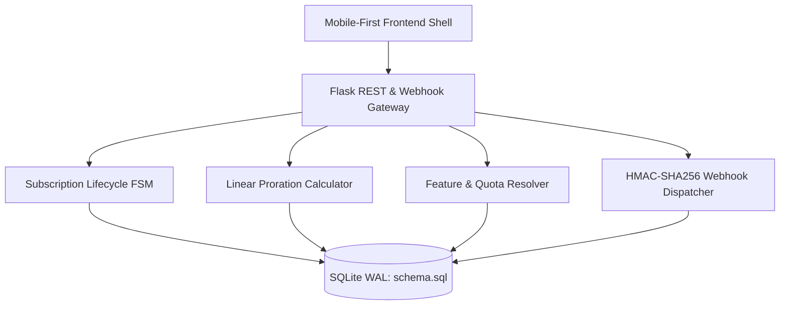

# Week 45: PulseSub - Mobile-First SaaS Subscription & Entitlements Platform

A mobile-first Software-as-a-Service (SaaS) subscription platform featuring:
- **Subscription Lifecycle FSM:** Deterministic states (`trialing`, `active`, `past_due`, `canceled`, `expired`).
- **Proration Engine:** Linear day-rate billing calculator for mid-cycle tier changes and immediate invoice settlement.
- **Entitlements Gatekeeping:** Route decorators enforcing boolean feature toggles and metered quota thresholds (80%, 90%, 100%).
- **Stripe-Compatible Webhook Simulator:** Inbound HMAC-SHA256 signature verification with 300-second replay window defense.
- **Mobile-First UI & Device Simulator:** Native-feeling mobile app shell with bottom navigation, touch targets, and desktop device frame switcher (iPhone 15, Pixel 8, iPad).

---

## Architecture Overview



---

## Project Structure

```text
week45_mobile_first_saas/
├── backend/
│   ├── app/
│   │   ├── billing/        # FSM and Proration calculation services
│   │   ├── config/         # Environment settings and secrets
│   │   ├── db/             # SQLite connection and migration engine
│   │   ├── models/         # Domain dataclasses and enums
│   │   ├── routes/         # REST API and webhook endpoints
│   │   ├── services/       # Entitlements and usage accumulators
│   │   └── __init__.py     # Flask factory
│   ├── data/
│   │   ├── pulsesub.db     # SQLite WAL database (auto-generated)
│   │   ├── schema.sql      # DDL tables, foreign keys, and indexes
│   │   └── seed.py         # Default plan tiers and demo account
│   ├── tests/              # Pytest test suite
│   ├── requirements.txt    # Python dependencies
│   └── run.py              # Application entrypoint
├── frontend/
│   ├── public/             # HTML shell and public static assets
│   └── src/
│       ├── css/            # Mobile-first CSS design tokens
│       └── js/             # Modular vanilla JS controllers
└── README.md
```

---

## Getting Started

### 1. Install Dependencies
```bash
cd backend
pip install -r requirements.txt
```

### 2. Initialize Database & Seed Plans
```bash
python data/seed.py
```

### 3. Run Development Server
```bash
python run.py
```
Open `http://localhost:5000` in your browser.

### 4. Run Test Suite
```bash
pytest --cov=app --cov-report=term-missing tests/
```
