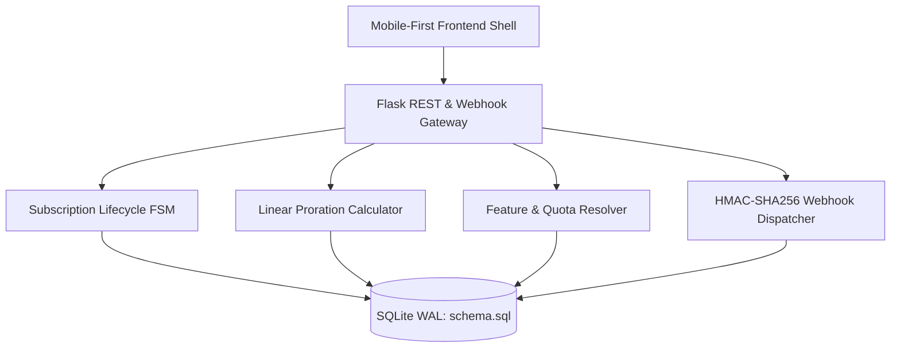

# Week 45: PulseSub - Mobile-First SaaS Subscription & Entitlements Platform

PulseSub is a mobile-first Software-as-a-Service (SaaS) subscription and entitlements engine engineered for modern web and mobile applications. It combines deterministic subscription state management, linear proration billing, metered quota enforcement with capacity alerts, and a Stripe-compatible webhook ingress pipeline.

---

## Key Features

- **Mobile-First Responsive Shell:** Designed following iOS Human Interface Guidelines and Android Material Design with persistent bottom tab navigation, touch-friendly 48px targets, and dark/light theme switching.
- **Device Viewport Simulator:** Embedded desktop switcher allowing live inspection in iPhone 15 (393x852), Pixel 8 (412x915), iPad (820x1180), and fluid responsive modes.
- **Deterministic Subscription FSM:** Enforces finite-state transitions across `trialing`, `active`, `past_due`, `canceled`, and `expired` states, preventing illegal lifecycle transitions.
- **Linear Day-Rate Proration Engine:** Computes exact down-to-the-second unconsumed credits and new tier charges for mid-cycle plan changes with automatic invoice settlement.
- **Entitlements & Quota Gatekeeper:** Route decorators gate features (`@require_feature`) and metered quotas (`@metered_quota`), injecting transparent headers (`X-Quota-Limit`, `X-Quota-Used`, `X-Quota-Remaining`, `X-Quota-Alert`).
- **Resource Gauges & Capacity Alerts:** Live meters tracking API calls, storage, and seats with visual threshold alert levels (80% warning, 90% critical, 100% exceeded).
- **Stripe-Compatible Webhook Dispatcher:** Inbound HMAC-SHA256 signature verification with a 300-second replay window defense and idempotent event deduplication.
- **Interactive Webhook Sandbox Console:** In-browser developer console utilizing the Web Crypto API to sign and dispatch mock Stripe events live.
- **Self-Serve Billing Portal:** Customer subscription dashboard with scheduled cancellation, resumption, invoice history, and standalone printable HTML receipts.

---

## Architecture Overview



---

## Project Structure

```text
week45_mobile_first_saas/
├── backend/
│   ├── app/
│   │   ├── billing/        # FSM, Proration, Invoices, Webhook security & dispatcher
│   │   ├── config/         # Environment settings and secrets
│   │   ├── db/             # SQLite connection and migration engine (WAL mode)
│   │   ├── models/         # Domain dataclasses, enums, and row parsers
│   │   ├── routes/         # REST API blueprints (auth, plans, subs, entitlements, usage, billing, webhooks)
│   │   ├── services/       # Entitlements gatekeeper, usage accumulators, decorators
│   │   └── __init__.py     # Flask application factory
│   ├── data/
│   │   ├── pulsesub.db     # SQLite WAL database (auto-generated)
│   │   ├── schema.sql      # DDL tables, foreign keys, and indexes
│   │   └── seed.py         # Default plan tiers and demo accounts
│   ├── tests/              # Comprehensive test suite (128 tests, 96% coverage)
│   ├── requirements.txt    # Python runtime dependencies
│   └── run.py              # Application entrypoint
├── frontend/
│   ├── public/             # HTML shell, simulator toolbar, and modals
│   └── src/
│       ├── css/            # Design tokens, device frames, responsive media queries
│       └── js/             # Modular vanilla JS controllers
│           ├── api.js             # Client API wrapper
│           ├── app.js             # Master controller & tab manager
│           ├── device_frame.js    # Viewport simulator controller
│           ├── portal_view.js     # Billing portal & receipts
│           ├── pricing_view.js    # Pricing matrix & proration sheet
│           ├── sandbox_console.js # Web Crypto webhook simulator
│           └── usage_view.js      # Resource meters & capacity badges
└── README.md
```

---

## REST API Reference

| Endpoint | Method | Description |
|:---|:---|:---|
| `/api/v1/auth/register` | `POST` | Register customer account and issue token |
| `/api/v1/auth/login` | `POST` | Authenticate customer and retrieve token |
| `/api/v1/auth/me` | `GET` | Resolve authenticated user profile |
| `/api/v1/plans` | `GET` | List active plan tiers, limits, and pricing |
| `/api/v1/subscriptions/current` | `GET` | Retrieve current subscription and plan tier |
| `/api/v1/subscriptions/subscribe` | `POST` | Create subscription and issue initial invoice |
| `/api/v1/subscriptions/change-tier`| `POST` | Dry-run preview or execute prorated tier upgrade |
| `/api/v1/subscriptions/cancel` | `POST` | Schedule cancel at period end or cancel immediately |
| `/api/v1/subscriptions/resume` | `POST` | Reactivate scheduled or canceled subscription |
| `/api/v1/entitlements/my-features` | `GET` | Retrieve feature flags, quotas, and usage summary |
| `/api/v1/entitlements/check` | `GET` | Check boolean entitlement for specific feature |
| `/api/v1/usage/record` | `POST` | Record resource consumption with idempotency key |
| `/api/v1/usage/summary` | `GET` | Current billing cycle usage and capacity alerts |
| `/api/v1/billing/invoices` | `GET` | List customer billing statements |
| `/api/v1/billing/invoices/<id>/receipt` | `GET` | Structured JSON receipt data |
| `/api/v1/billing/invoices/<id>/html` | `GET` | Printable HTML receipt with print styling |
| `/api/v1/billing/invoices/<id>/pay` | `POST` | Settle open invoice and reactivate past_due subscription |
| `/api/v1/webhooks/stripe` | `POST` | Stripe-compatible HMAC-SHA256 webhook ingress |

---

## Getting Started

### 1. Prerequisites
- Python 3.10+
- Modern Web Browser (Chrome, Firefox, Safari, Edge)

### 2. Install Dependencies
```bash
cd backend
pip install -r requirements.txt
```

### 3. Initialize Database & Seed Plans
```bash
python data/seed.py
```

### 4. Run Development Server
```bash
python run.py
```
Open `http://localhost:5000` to interact with the mobile application shell and simulator.

### 5. Run Test Suite & Quality Gates
```bash
# Run pytest with code coverage (96% across 128 tests)
pytest --cov=app --cov=data --cov-report=term-missing tests/

# Flake8 style check (88 chars limit)
flake8 --max-line-length=88 .

# Black formatting verification
black --check .

# isort import verification
isort --profile black --check-only .

# Bandit AST security scanner
bandit -r app data
```

---

## Concurrency & Performance Benchmarks

- **SQLite WAL Concurrency:** Benchmarked under 50 simultaneous worker threads executing concurrent metered consumption writes with zero `database is locked` lockouts.
- **Webhook Replay Window:** Rejects signatures older than 300 seconds to protect against replay attacks.
- **Code Coverage:** 96% total coverage across 1,591 executable statements.
