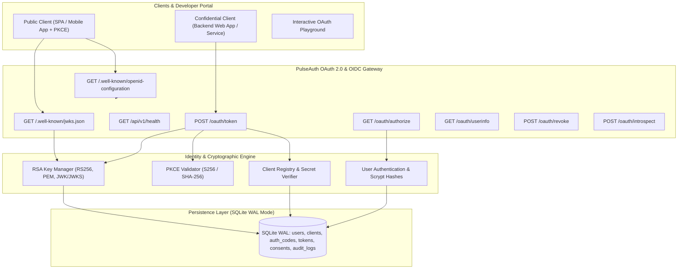

# Week 46: OAuth 2.0 / OpenID Connect Provider Service - PulseAuth

<div align="center">


<p align="center">
  <strong>A production-grade, standards-compliant Identity Provider (IdP) and Authorization Server implementing OAuth 2.0 (RFC 6749), Proof Key for Code Exchange (PKCE - RFC 7636), OpenID Connect Core 1.0 (OIDC), Asymmetric RS256 JWT Issuance, JWKS Key Distribution (RFC 7517), Token Revocation (RFC 7009), Token Introspection (RFC 7662), and an Interactive OAuth Playground.</strong>
</p>

</div>

---

## Table of Contents

- [Overview](#overview)
- [System Architecture](#system-architecture)
- [Standards & RFC Compliance](#standards--rfc-compliance)
- [Cryptographic Engine & Key Architecture](#cryptographic-engine--key-architecture)
- [Database Schema & Persistence](#database-schema--persistence)
- [REST API Reference](#rest-api-reference)
- [Quality Gates & Automated Test Suite](#quality-gates--automated-test-suite)
- [Quickstart Guide](#quickstart-guide)
- [Project Structure](#project-structure)
- [License](#license)

---

## Overview

Week 46 of **Project 52: Phase 3 (Production)** delivers **PulseAuth**, an enterprise-grade Authorization Server and OpenID Connect Identity Provider. 

Modern microservices, single-page applications (SPAs), and mobile apps require robust identity delegation without sharing user credentials. PulseAuth establishes a hardened identity core providing:
1. **Asymmetric Cryptography**: RS256 token signing with 2048-bit RSA keys and RFC 7517 JWKS key distribution for decentralized token verification.
2. **Public & Confidential Client Support**: Public clients (SPAs/mobile) with mandatory PKCE (RFC 7636) and confidential server applications with authenticated client secrets.
3. **OpenID Connect Discovery**: Automated client auto-configuration via `/.well-known/openid-configuration` and `/.well-known/jwks.json`.
4. **Resilient Persistence**: High-concurrency SQLite storage with Write-Ahead Logging (WAL) and 30-second busy timeout locks.
5. **Zero-Emoji Architecture**: 100% compliance with strict production engineering and accessibility standards.

---

## System Architecture



---

## Standards & RFC Compliance

| RFC / Standard | Title | Status in PulseAuth |
|:---|:---|:---|
| **RFC 6749** | The OAuth 2.0 Authorization Framework | Implemented (`/oauth/authorize`, `/oauth/token` for `authorization_code`, `client_credentials` & `refresh_token`) |
| **RFC 7636** | Proof Key for Code Exchange (PKCE) | Implemented (`S256` SHA-256 challenge, `plain` fallback, 43-128 chars) |
| **OpenID Connect** | Core 1.0 & Discovery Protocol | Implemented (ID Tokens, UserInfo `/oauth/userinfo`, `/.well-known/openid-configuration`) |
| **RFC 7517** | JSON Web Key (JWK / JWKS) | Implemented (`/.well-known/jwks.json` distributing RSA public keys) |
| **RFC 7518** | JSON Web Algorithms (JWA) | Implemented (`RS256` signing, Base64urlUInt modulus/exponent) |
| **RFC 7519** | JSON Web Token (JWT) | Implemented (`iss`, `sub`, `aud`, `exp`, `iat`, `jti`, `kid` headers) |
| **RFC 7009** | OAuth 2.0 Token Revocation | Implemented (`POST /oauth/revoke` with token family invalidation) |
| **RFC 7662** | OAuth 2.0 Token Introspection | Implemented (`POST /oauth/introspect` with resource server auth) |

---

## Cryptographic Engine & Key Architecture

The cryptographic subsystem is managed by [`RSAKeyManager`](file:///c:/Users/User/Documents/Github/Personal/VSCODE_PROJECT52/PROJECT52-PHASE3/week46_oauth_provider/backend/app/crypto/rsa_manager.py):
- **Key Generation**: 2048-bit RSA keypair generated using Python's `cryptography` library with standard public exponent `e = 65537`.
- **Key Identification (`kid`)**: Deterministic 16-character hexadecimal fingerprint computed from the SHA-256 digest of the SubjectPublicKeyInfo PEM serialization.
- **JWKS Export**: Converts RSA modulus `n` and exponent `e` into RFC 7518 unpadded Base64urlUInt strings. For `e = 65537`, the representation evaluates strictly to `"AQAB"`.
- **JWT Operations**: Asymmetric signing (`RS256`) with automatic injection of the `kid` header parameter, and public verification enforcing algorithm and issuer claims.

---

## Database Schema & Persistence

SQLite runs with Write-Ahead Logging (`PRAGMA journal_mode = WAL;`) and a 30-second busy timeout (`PRAGMA busy_timeout = 30000;`):

- **`users`**: User identities, scrypt password hashes, and profile metadata.
- **`clients`**: OAuth 2.0 client registrations (`public` vs `confidential`), hashed secrets, authorized redirect URIs, grant types, and allowed scopes.
- **`authorization_codes`**: Ephemeral 60-second authorization codes linked to client, user, redirect URI, PKCE code challenge, and OIDC nonce.
- **`tokens`**: Issued access tokens, refresh tokens, and ID tokens with SHA-256 value hashes, expiration timestamps, revocation markers, and token family lineage IDs.
- **`consents`**: Persisted user scope grants per client.
- **`audit_logs`**: Security telemetry recording authorization events, token issuances, revocations, and authentication failures.

---

## REST API Reference

### 1. Discovery & Key Distribution
| Method | Endpoint | Description | Status Codes |
|:---|:---|:---|:---|
| `GET` | `/.well-known/openid-configuration` | RFC 8414 / OIDC discovery metadata document | `200 OK` |
| `GET` | `/.well-known/jwks.json` | RFC 7517 JSON Web Key Set distributing public signing keys | `200 OK` |
| `GET` | `/api/v1/health` | Service vitality probe reporting issuer and active `kid` | `200 OK` |

### 2. OAuth 2.0 & OIDC Endpoints (Day 2 - Day 4)
| Method | Endpoint | Description | Grant Type / RFC |
|:---|:---|:---|:---|
| `GET` / `POST` | `/oauth/authorize` | Authorization endpoint with scope consent, PKCE enforcement, HTML UI & JSON API | RFC 6749, RFC 7636 |
| `POST` | `/oauth/token` | Token issuance endpoint for code exchange, client credentials, and refresh | RFC 6749 |
| `GET` / `POST` | `/oauth/userinfo` | OIDC UserInfo endpoint returning verified profile claims | OIDC Core 1.0 |
| `POST` | `/oauth/revoke` | Token revocation endpoint | RFC 7009 |
| `POST` | `/oauth/introspect` | Token introspection endpoint for resource servers | RFC 7662 |

#### Authorization Endpoint (`/oauth/authorize`)
- `response_type`: Must be strictly `code`.
- `client_id`: Registered client identifier (`confidential` or `public`).
- `redirect_uri`: Exact registered redirect target URL.
- `scope`: Space-delimited requested permissions (subset of client's `allowed_scopes`).
- `state`: Recommended opaque CSRF protection value, preserved verbatim in callbacks.
- `code_challenge`: RFC 7636 PKCE verification challenge (mandatory for public clients).
- `code_challenge_method`: `S256` (default & recommended) or `plain`.
- `nonce`: OIDC replay protection token preserved into downstream ID tokens.

#### Token Endpoint (`POST /oauth/token`)
Accepts `application/x-www-form-urlencoded` or `application/json`. Client authentication via HTTP Basic Header (`client_secret_basic`), form body (`client_secret_post`), or public client identification (`none`).

- **Grant Type: `authorization_code`**
  - Required parameters: `grant_type=authorization_code`, `code`, `redirect_uri`, `client_id` (or Basic auth).
  - PKCE parameter: `code_verifier` (mandatory if code challenge was present during authorization).
  - Returns: `access_token` (RS256 JWT, 1-hour TTL), `token_type` (`Bearer`), `expires_in` (`3600`), `refresh_token` (opaque 32-byte hex, 30-day TTL), `scope`, and `id_token` (RS256 JWT containing OIDC claims and nonce, if `openid` scope requested).
- **Grant Type: `client_credentials`**
  - Required parameters: `grant_type=client_credentials`, `scope` (optional subset of allowed scopes). Client must be `confidential` and successfully authenticated.
  - Returns: M2M service `access_token` (RS256 JWT, 1-hour TTL), `token_type` (`Bearer`), `expires_in` (`3600`), `scope`.
- **Grant Type: `refresh_token`**
  - Required parameters: `grant_type=refresh_token`, `refresh_token`, `client_id` (or Basic auth).
  - Scope parameter: Optional downscoped permissions (must be a subset of original granted scopes; scope expansion is rejected).
  - Refresh Token Rotation (RTR): Consumed refresh token is invalidated immediately; a new rotated refresh token and fresh RS256 access token are issued within the same `token_family_id`.
  - Reuse Detection Defense: Replay of an already-consumed refresh token immediately triggers family revocation, invalidating all associated access and refresh tokens.

#### UserInfo Endpoint (`GET` / `POST` `/oauth/userinfo`)
- Header: `Authorization: Bearer <access_token>`.
- Token Validation: Cryptographically verified RS256 signature, expiration check, active database verification, and validation that `openid` scope was granted.
- Returns JSON claims:
  - Base: `sub` (User ID).
  - Scope `email`: `email`, `email_verified`.
  - Scope `profile`: `name`, `preferred_username`.

#### Token Revocation Endpoint (`POST /oauth/revoke`)
- RFC 7009 compliant token revocation supporting access and refresh tokens.
- Parameters: `token` (required), `token_type_hint` (`access_token` or `refresh_token`). Client authentication via Basic header, body, or public client ID.
- Behavior: Revoking a refresh token cascades to invalidate all active tokens in that `token_family_id`. Responds with HTTP 200 OK for valid, unowned, or already-revoked tokens to prevent information leakage.

#### Token Introspection Endpoint (`POST /oauth/introspect`)
- RFC 7662 compliant token introspection for resource servers and confidential clients.
- Authentication: Mandatory confidential client authentication (`client_secret_basic` or `client_secret_post`). Public clients are rejected.
- Parameters: `token` (required), optional `token_type_hint`.
- Returns:
  - If active: `{ "active": true, "scope": "...", "client_id": "...", "sub": "...", "token_type": "Bearer", "exp": 1731234567, "iat": 1731230967, "iss": "..." }`.
  - If invalid, expired, or revoked: `{ "active": false }`.

### 3. Protected Resource Server Endpoints (Day 5)
Protected by `@require_oauth_token` middleware validating RS256 Bearer JWTs, checking real-time database revocation, and enforcing granular scopes.

| Method | Endpoint | Required Scope | Description |
|:---|:---|:---|:---|
| `GET` | `/api/v1/resource/profile` | `profile` / `read:profile` / `openid` | Returns authenticated user profile and authorized scopes |
| `GET` | `/api/v1/resource/documents` | `read:documents` | Returns sensitive confidential documents for the user/client |
| `POST` | `/api/v1/resource/documents` | `write:documents` | Creates a new document linked to caller's subject ID |

### 4. Developer Client Management & User Auth Endpoints (Day 5)
| Method | Endpoint | Description |
|:---|:---|:---|
| `GET` | `/api/v1/clients` | List all registered OAuth 2.0 clients (omits secret hashes) |
| `POST` | `/api/v1/clients` | Register new OAuth 2.0 client application (RFC 7591) |
| `GET` | `/api/v1/clients/<client_id>` | Fetch single client configuration details |
| `POST` | `/api/v1/clients/<client_id>/rotate-secret` | Rotate confidential client secret |
| `DELETE` | `/api/v1/clients/<client_id>` | Delete registered client record |
| `POST` | `/api/v1/auth/login` | Authenticate user credentials and return profile |
| `POST` | `/api/v1/auth/register` | Register new user account with scrypt password hashing |
| `GET` | `/api/v1/auth/users` | List registered user profiles (omits password hashes) |

---

## Quality Gates & Automated Test Suite

All Python code conforms strictly to the 5 enterprise quality gates:
- **Flake8**: 0 lint errors (max line length: 88, complexity checked).
- **Black**: 100% compliant formatting.
- **isort**: Deterministic import ordering.
- **Bandit**: 0 security vulnerabilities identified (`-ll` severity).
- **Pytest**: 126 unit and integration tests passing with **96.07% branch coverage**.

### Running Quality Gates
```powershell
cd week46_oauth_provider/backend
python scripts/run_quality_checks.py
```

---

## Quickstart Guide

### 1. Installation
```powershell
cd week46_oauth_provider/backend

# Create and activate virtual environment
python -m venv venv
.\venv\Scripts\Activate.ps1

# Install dependencies
pip install -r requirements.txt
```

### 2. Seed Database
```powershell
python data/seed.py
```
*Seeds default users (`developer@pulseauth.dev`, `admin@pulseauth.dev`) and demo clients (`pulse-web-app`, `pulse-mobile-app`, `pulse-m2m-service`).*

### 3. Start Development Server
```powershell
python run.py
```
*Server listening on `http://127.0.0.1:5000`.*

---

## Project Structure

```text
week46_oauth_provider/
├── backend/
│   ├── app/
│   │   ├── config/
│   │   │   ├── __init__.py
│   │   │   └── settings.py          # Environment profiles & configuration
│   │   ├── crypto/
│   │   │   ├── __init__.py
│   │   │   └── rsa_manager.py       # 2048-bit RSA keypair, JWKS & RS256 engine
│   │   ├── db/
│   │   │   ├── __init__.py
│   │   │   └── connection.py        # SQLite WAL connection manager
│   │   ├── models/
│   │   │   ├── __init__.py
│   │   │   ├── auth_code_model.py   # Ephemeral authorization code persistence & TTL
│   │   │   ├── client_model.py      # OAuth client registration & secret verification
│   │   │   ├── consent_model.py     # User scope grants & consent records
│   │   │   ├── token_model.py       # Issued token persistence, SHA-256 hash & revocation
│   │   │   └── user_model.py        # User authentication & scrypt password hashing
│   │   ├── routes/
│   │   │   ├── __init__.py
│   │   │   ├── auth_routes.py       # GET & POST /oauth/authorize controller
│   │   │   ├── client_routes.py     # Developer client registration & management API
│   │   │   ├── discovery_routes.py  # /.well-known/openid-configuration & jwks.json
│   │   │   ├── introspection_routes.py # POST /oauth/introspect RFC 7662 controller
│   │   │   ├── resource_routes.py   # Protected demo resource server APIs
│   │   │   ├── revocation_routes.py # POST /oauth/revoke RFC 7009 controller
│   │   │   ├── token_routes.py      # POST /oauth/token endpoint for code, m2m, refresh
│   │   │   ├── user_auth_routes.py  # User authentication and registration API
│   │   │   └── userinfo_routes.py   # GET & POST /oauth/userinfo OIDC user claims endpoint
│   │   ├── services/
│   │   │   ├── __init__.py
│   │   │   ├── audit_service.py     # Structured security audit logging
│   │   │   ├── auth_code_service.py # Authorization code lifecycle & request validator
│   │   │   ├── client_auth_service.py # RFC 6749 client authentication (Basic, post, none)
│   │   │   ├── pkce_service.py      # RFC 7636 PKCE S256/plain verifier & challenge
│   │   │   ├── refresh_service.py   # Refresh token rotation & reuse detection (RFC 6749)
│   │   │   ├── token_guard.py       # @require_oauth_token security middleware
│   │   │   └── token_service.py     # RS256 JWT access tokens, OIDC ID tokens, refresh tokens
│   │   ├── templates/
│   │   │   └── consent.html         # High-contrast interactive user consent screen
│   │   └── __init__.py              # Application factory & blueprint registration
│   ├── data/
│   │   ├── schema.sql               # Relational SQLite database schema
│   │   └── seed.py                  # Database seeding script with demo clients/users
│   ├── scripts/
│   │   └── run_quality_checks.py    # 5-stage automated quality gates CLI
│   ├── tests/
│   │   ├── conftest.py              # Pytest fixtures & isolated test app
│   │   ├── test_auth_code_service.py # Code lifecycle, expiration & URL builder tests
│   │   ├── test_authorize_routes.py  # Authorization endpoint integration tests
│   │   ├── test_client_auth_service.py # Client authentication unit tests
│   │   ├── test_client_routes.py    # Client registration and management tests
│   │   ├── test_consent_model.py    # Consent model persistence unit tests
│   │   ├── test_coverage_edge_cases.py
│   │   ├── test_database_and_models.py
│   │   ├── test_discovery_and_jwks.py
│   │   ├── test_introspection.py    # RFC 7662 token introspection tests
│   │   ├── test_pkce_service.py     # RFC 7636 Appendix B test vector & syntax tests
│   │   ├── test_refresh_rotation.py # Refresh token rotation & reuse detection tests
│   │   ├── test_resource_routes.py  # Protected resource server endpoint tests
│   │   ├── test_revocation.py       # RFC 7009 token revocation tests
│   │   ├── test_rsa_manager.py
│   │   ├── test_token_guard.py      # @require_oauth_token middleware unit tests
│   │   ├── test_token_model.py      # Token persistence & revocation tests
│   │   ├── test_token_routes.py     # Token endpoint integration tests
│   │   ├── test_token_service.py    # RS256 token generation & verification tests
│   │   ├── test_user_auth_routes.py # User authentication API tests
│   │   └── test_userinfo_routes.py  # OIDC UserInfo endpoint tests
│   ├── .coveragerc                  # Pytest coverage thresholds (90%+)
│   ├── .flake8                      # Flake8 configuration (88-char limit)
│   ├── pyproject.toml               # Black, isort, and pytest settings
│   ├── requirements.txt             # Production & development dependencies
│   └── run.py                       # Standalone server runner
├── frontend/
│   ├── public/                      # Static entry points
│   └── src/                         # Modular vanilla ES6 components & styles
└── README.md                        # Master project documentation
```

---

## License

This project is open-source under the [MIT License](LICENSE). Part of [Project 52: Phase 3](https://github.com/pak-pow/PROJECT52-PHASE3).
